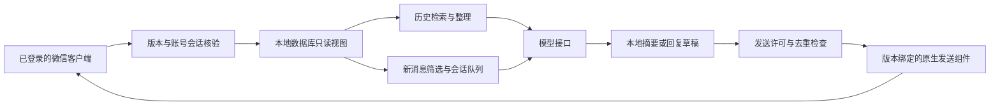

# Mydex

**让本地聊天记录变成可用的记忆，让 AI 在你授权的会话里提供帮助。**

版本：0.1.0 · 源码整理日期：2026-10-21

Mydex 是 Windows 微信桌面端的本地 AI 助手方案。它连接已登录客户端，在核实账号、进程和会话后读取本地聊天记录，用模型完成整理或回复，再经本地发送通道把回复送回对应会话。

## 两个核心用途

### 1. 聊天记录整理：把讨论变成可回顾的信息

针对授权会话，按时间、话题或问题寻找本地已有记录，整理讨论摘要、决定、待办和待确认问题。例如“这周项目群讨论了什么？”“上次对这个问题达成了什么结论？”程序负责检索和计数，模型负责表达；无法读取的附件和缺失历史明确标注。

**当前已有**历史读取、时间与话题检索、统计上下文和手动总结入口。**定期日报/周报是扩展方案**，本次没有上线通用周期调度器，也没有实际发送定时报告。详见[产品说明](docs/PRODUCT.md)。

### 2. 会话内 AI 回复：在群聊和私聊中协作

在授权范围内处理群内真实 @、指定联系人私聊，以及可选的低频群聊参与。每个会话独立排队和保存上下文，共享有限模型并发。发送前检查当前账号与会话，发送后核对回执；不确定是否发送成功时暂停，避免重复回复。

## 先读这三份文档

- [方法论：进程连接 → 本地记录 → AI → 回复](docs/METHODOLOGY.md)
- [产品叙事、两大用途和演示边界](docs/PRODUCT.md)
- [安装、迁移和运行说明](docs/SETUP.md)

## 仓库结构

| 目录 | 内容 |
|---|---|
| `app/` | 控制台、记录读取、会话队列、模型适配、发送保护与测试 |
| `app/research/` | 本地文件/内存读取、数据库页验证、原生组件源码和版本绑定工具 |
| `deployment/` | 账号录入、模型配置、只读预检、启动停止及桌面对话桥接 |
| `vendor/` | MinHook 源码与原有许可证，LIEF 许可证说明 |
| `docs/` | 方法论、产品说明、部署边界和验证记录 |

## 当前交付范围

这是从既有小主机项目整理出的**源码与方法论版本**，不是适配任意微信版本的一键安装器。现有适配针对微信 Windows `4.1.15.13`，运行还受文件 SHA-256 校验约束。升级微信后需要重新验证，不能删除校验强行启动。

本地处理不等于所有内容都离线：使用远端模型时，选中的聊天上下文会发送给配置的模型服务。

第三方代码沿用各自许可证；本版本没有替作者替第三方授予额外授权。仓库先按私有方式保存。
